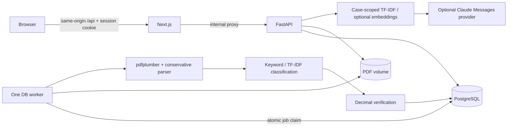

# Architecture

DocVerify has one Next.js application, one FastAPI backend, PostgreSQL, and one Python processing worker. Original PDFs live on a shared persistent local volume. SQLite supports native development and isolated tests. There is no Redis, Celery, external vector database, or agent framework.

## Requests and trust boundaries

The browser uses `/api/*` on its own origin. Next.js rewrites forward requests, cookies, and response cookies to the backend. Passwords are hashed with Argon2; random session tokens are stored in an HttpOnly, SameSite=Lax cookie, and only SHA-256 token hashes are stored in the database. Sessions expire after seven days. Login rotates the current session. Unsafe authenticated requests require a per-session CSRF token in `X-CSRF-Token`; the browser obtains it from `/auth/me`. An Origin check also covers auth requests. In-process throttling limits authentication attempts to 20/minute per client IP; it is a local mitigation, not a production distributed limiter.

Every case endpoint filters by the current user. Every document endpoint resolves the owning case. This includes file views, correction history, retry/delete, exports, findings, and search. Unauthorized access returns 404, avoiding direct existence disclosure. The storage directory is not served statically. API responses use `Cache-Control: no-store`.

Document text is untrusted evidence. The optional provider receives selected case chunks and code-produced findings, has no tools/actions, and must return a JSON answer plus retrieved chunk IDs. The server validates the schema and citation membership. No key means no generated answer. Live generation has residual grounding risk even with valid IDs.

## Database relationships

| Table | Relationships and purpose |
| --- | --- |
| users | Own cases and hashed-token sessions |
| sessions | User FK, CSRF secret, expiry |
| cases | User FK; name, Decimal tolerance string, source and verified revisions |
| documents | Case FK; server-generated storage name, processing status, first retained original JSON, latest raw JSON, current correction JSON, review/run revisions, source limitations and classifier outputs |
| pages | Document FK; page number and original selectable text |
| chunks | Document FK; original page passage, extraction revision, optional normalized embedding and model/config metadata |
| processing_runs | Document FK, successful raw revision or failed-attempt record, extraction/pages, parser/model metadata; legacy time can be unknown |
| jobs | Unique document FK; attempt count, status, lease token/time, available time, error |
| corrections | Document/user FKs; full before/after snapshots, timestamp, extraction/document revisions, action and optional source-resolution reason |
| findings | Case FK; stable row/pair/rule and material hash, type, severity, expected/observed values, source references, review status |

Foreign keys cascade case/document deletion to derived records; uploaded files are removed after the transaction commits. Database rows and filesystem deletion cannot be a single atomic transaction, so a filesystem error after commit could leave an orphan file. A future reconciliation task should clean orphans. Alembic's explicit initial revision defines the schema; the application does not silently create production tables.

## Processing pipeline

1. Check ownership, batch limit, streamed file-size limit, PDF signature/content, and page count. Generate a UUID filename. Upload batches are all-or-nothing; validation failures remove files already written.
2. Persist a pending document and its unique pending job. The HTTP request returns before processing.
3. The worker finds eligible jobs with `SELECT … FOR UPDATE SKIP LOCKED` on PostgreSQL, then atomically updates status/attempt/lease with a conditional `UPDATE … RETURNING`. SQLite ignores the row-lock clause; the conditional update still prevents duplicate claims in the tested local case.
4. Parse selectable text per page; raise a terminal “OCR required” error if unusable. Parse supported labelled metadata and line formats. Missing/conflicting fields stay null. Source snippets and unique exact-match bounding boxes retain document/page provenance. Coordinates are PDF points `[x0, top, x1, bottom]`, with a top-left text coordinate origin.
5. Classify using keyword rules plus a synthetic TF-IDF/logistic model. Rules provide the primary type; ML supplies an explicitly reviewable prediction and is used for unknown rule types. Disagreement requires review. No calibrated confidence is claimed.
6. Chunk original text by page, approximately 700 characters with two-line overlap. Store optional Sentence Transformers vectors; inference failures preserve keyword-only indexing.
7. Lock the case, then verify the lease token. Replace derived pages/chunks only for the current lease; persist extraction, refresh case findings, and complete the job in one transaction. Repeated completion is idempotent, and deleted/stale jobs cannot overwrite a newer extraction.

Automatic retries are bounded to three attempts with exponential delay capped at 30 seconds. Invalid/scanned PDFs are terminal. Transient errors return to pending. Processing leases older than 300 seconds are eligible for recovery; exhausted stale leases become failed. A user may explicitly retry a terminal document, resetting the attempt budget. There is one worker and no heartbeat; processing unusually slow optional models can exceed the lease and cause duplicate computation, but lease fencing prevents stale writes.

## Review, history, and verification

`review_state.effective_data` selects current corrections or latest raw data and combines field validation with unresolved source limitations. `corrections.save_correction` validates row identities and immutable provenance, conditionally checks/increments the expected document revision, records a before/after audit and refreshes results in one transaction. Stale tabs return 409. A separate manually reasoned action resolves a source limitation and records an audit; a normal field save cannot establish that OCR occurred.

The worker retains `original` once, appends processing runs (including observed failures), and replaces only latest page/chunk indexes. Corrections remain anchored to their extraction revision even when raw rows change; no automatic rebase guesses identity. `0002` is additive and backfills only a retained legacy snapshot, with null processing time and unknown older correction bases. It cannot reconstruct overwritten runs. Raw row IDs are reused only for unique unchanged source anchors; new/ambiguous mappings get run-bound identities.

Pure `matching`/`verification` code has no database dependency. Identifiers precede compatible exact descriptions; fuzzy-only candidates, conflicts, duplicates and competing matches require review. Decimal rules check line multiplication, subtotal sum, subtotal+tax and explicit tax rate. Missing values stay unknown; units use aliases only and money requires compatible currency. `comparison_scope` selects one reference with individual targets; several invoices raise an unsupported-aggregation review. Failed/unreadable/incomplete documents are visible in case readiness.

`case_verification.refresh_case` persists findings and case source/verified revisions under the case lock. Stable hashes include rule, pair, row IDs and material facts. Reordering persisted rows preserves unchanged finding reviews; changed facts reopen findings. Unique legacy reviews may carry forward when their displayed material content is unchanged. CSV escapes spreadsheet formulas; JSON uses effective data with first/latest raw snapshots.

Original-scope questions contain PDF evidence and deterministic checks over the latest raw extraction. Reviewed scope checks effective corrected values. Reviewed scope additionally contains complete effective records, document/run revisions and correction audit provenance. Human corrections have reviewed-record citations and cannot be presented as original quoted passages. Snapshot revision is returned so the UI can mark answers stale after a source change. Citation IDs must belong to retrieved passages or supplied reviewed records. These checks do not independently verify model entailment.

Stored embeddings include resolved model/configuration metadata. An absent, incompatible, or failed optional model falls back visibly to keywords. Runtime evaluation uses the actual page chunker/ranker; historical whole-PDF metrics remain separately labelled.

## Code map

- `main.py`: app composition, middleware and schema readiness.
- `api/accounts.py`, `cases.py`, `documents.py`, `evidence.py`, `exports.py`, `demo.py`: focused entrypoints; `access.py` centralizes ownership.
- `services/corrections.py`, `exports.py`, `presentation.py`: transaction/current-state orchestration.
- `review_state.py`, `comparison.py`, `matching.py`, `verification.py`: pure transformations and rules; `case_verification.py` persists results.
- `extraction.py`, `classification.py`, `retrieval.py`, `worker.py`: PDF, model, evidence/provider, and job boundaries.
- `frontend/lib/use-case-workspace.ts`: guarded case/document loading and dirty-navigation protection.
- `frontend/components`: source editor and coherent documents/findings/comparison/evidence panels.
- `scripts/verify.py`, `.github/workflows/verify.yml`: portable checks and authored CI; external DB tests require an explicit opt-in.

See CODE_WALKTHROUGH.md for complete request traces.
